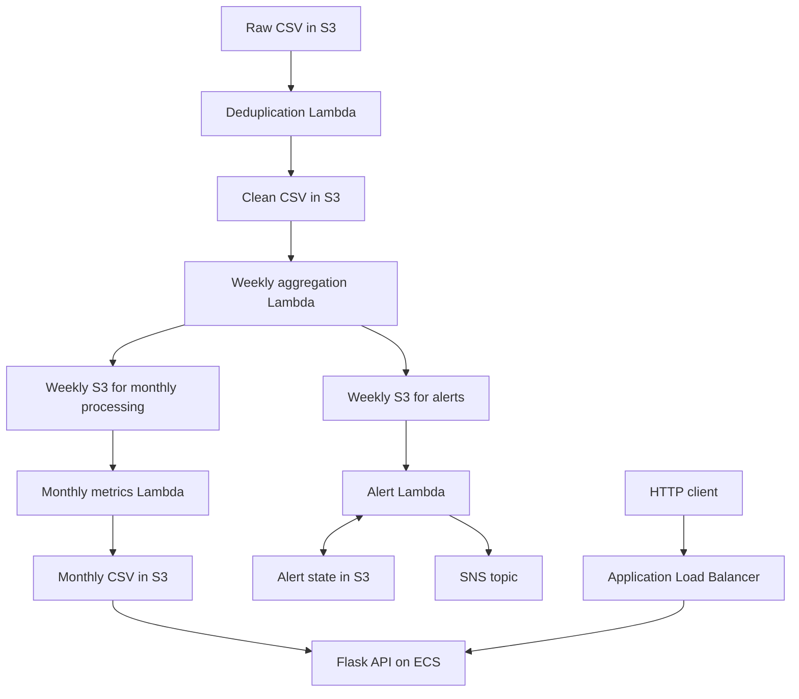

<div align="center">

# AquaSenseCloud

**An event-driven temperature-data pipeline on AWS**

Python · S3 · Lambda · SNS · Flask · Docker · ECR · ECS · CloudFormation

[Architecture](docs/ARCHITECTURE.md) · [Deployment guide](docs/DEPLOYMENT.md) · [Team](AUTHORS.md) · [MIT License](LICENSE)

</div>

## The project

AquaSenseCloud turns temperature CSV uploads into cleaned records, weekly aggregates, monthly metrics and threshold notifications. A containerised Flask API reads the monthly results from S3 and exposes them through three query endpoints.

Developed by **José Montesinos Pineda, Enrique Vicente Pujante and Alejandro Gómez Javaloyes** for *Infraestructura para la Computación de Altas Prestaciones*, Grado en Ciencia e Ingeniería de Datos, Universidad de Murcia, 2025/2026.

## Architecture



The report documents the AWS deployment. This repository includes the application and Lambda code plus **partial CloudFormation infrastructure**: networking, security groups and an EC2 Docker-build host. S3, Lambda triggers, SNS, ECR, ECS and the load balancer still require configuration described in the deployment guide.

## What it demonstrates

- Event-driven processing across S3 buckets and four Lambda stages.
- Date-based deduplication and weighted weekly aggregation.
- Monthly statistics exposed through a REST API.
- Persistent notification state and SNS integration.
- Docker packaging and an ECR/ECS/ALB deployment workflow.
- Network separation through VPC subnets and security groups.

## My contribution

**Enrique Vicente Pujante:** SNS alerts and state storage; AWS CLI/Docker commands; container build and ECR publishing; participation in CloudFormation, load-balancer/ECS configuration, integration testing and the report. The team's report is the source for this attribution. See [AUTHORS.md](AUTHORS.md) for all three contributors.

## Run the offline tests

No AWS account or credentials are required for the tests. Use Python 3.12:

```bash
python -m venv .venv
# macOS/Linux: source .venv/bin/activate
# Windows PowerShell: .\.venv\Scripts\Activate.ps1
python -m pip install -r requirements-dev.txt
python -m unittest discover -s tests -v
```

Tests run the processing stages with in-memory S3 and mocked SNS, check API responses, replay handling and error cases. The included [sample CSV](data/sample_temperatures.csv) is synthetic. The suite does not create AWS resources or send notifications.

## API

| Route | Query | Result |
| --- | --- | --- |
| `/temp` | `year=2025&month=1` | Mean of weekly temperature values assigned to the month |
| `/sd` | `year=2025&month=1` | Maximum input deviation assigned to the month |
| `/maxdiff` | `year=2025&month=2` | Difference between the month's maximum weekly value and the previous available month's maximum |
| `/health` | None | `OK` if the Flask process responds |

Successful metric values retain the original CSV-string representation. Missing/invalid parameters return 400; missing dates return 404; S3 read failures return 500. Health checks do not test S3 availability.

For local API use against your own S3 bucket:

```bash
# Configure an AWS profile/role separately; do not put credentials in source files.
export AWS_REGION=us-east-1
export MONTHLY_BUCKET=your-monthly-bucket
python api/application.py
```

PowerShell equivalents: `$env:AWS_REGION="us-east-1"` and `$env:MONTHLY_BUCKET="your-monthly-bucket"`.

The API reads `datos_procesados.csv` by default. To build the container:

```bash
docker build -t aquasensecloud-api ./api
```

The image serves the API with Gunicorn on port 5000. Use an ECS task role for S3 access; no credentials are embedded in the image. See [deployment instructions](docs/DEPLOYMENT.md).

## Repository

| Location | Contents |
| --- | --- |
| `api/` | Flask application, Dockerfile and runtime dependencies |
| `lambdas/` | Deduplication, weekly, monthly and alert handlers |
| `infra/network.yaml` | Parameterised network and EC2 bootstrap template |
| `data/` | Synthetic input example and schema notes |
| `tests/` | Offline pipeline and API tests |
| `docs/` | Architecture, deployment and publication changes |
| `AUTHORS.md` | Shared authorship and contributions |
| `LICENSE` | MIT licence |

## Scope

The weekly deviation is a weighted average of supplied deviations, not a newly calculated population standard deviation. Monthly grouping uses the week-start month; cross-month weighting remains unfinished in the academic source. S3 state updates are not transactional, so sequential replay tests do not imply exactly-once processing under concurrency. See [assumptions and limitations](docs/ARCHITECTURE.md).

Publication preparation fixes monthly reload types, failed-alert handling and configuration portability. No AWS deployment was performed during this preparation, and the Docker image and CloudFormation stack have not been runtime-validated here.

## License

Code and original documentation are released under the [MIT License](LICENSE), with all three authors credited. Third-party dependencies and external datasets retain their own terms. The original institutional assignment and laboratory report are not redistributed in this package.
